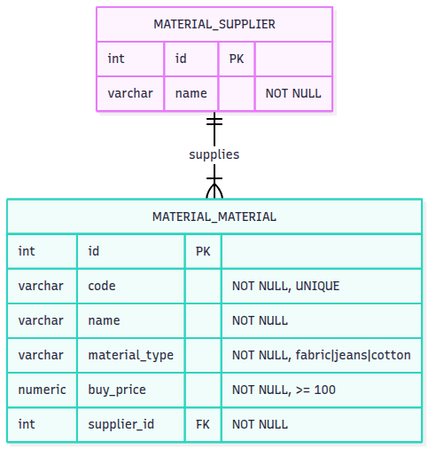

# Material Registry — Odoo 14 Backend Test

## Setup

### 1. Run PostgreSQL

```bash
docker compose up -d db
```

### 2. Inisialisasi database dan install modul

```bash
docker compose run --rm odoo odoo -d material_db -i base \
    --stop-after-init --without-demo=all

docker compose run --rm odoo odoo -d material_db -i material_registry \
    --stop-after-init --without-demo=all
```

### 3. Jalankan Odoo

```bash
docker compose up -d odoo
```

Buka `http://localhost:8069`.

- Login: `admin`
- Password: `admin`

## Dokumentasi API

### Autentikasi

```bash
curl -i -c cookies.txt -X POST http://localhost:8069/web/session/authenticate \
  -H 'Content-Type: application/json' \
  -d '{"jsonrpc":"2.0","params":{"db":"material_db","login":"admin","password":"admin"}}'
```

Semua request berikutnya menggunakan cookie tersebut (`-b cookies.txt`). Jika belum login, Odoo akan mengalihkan ke halaman login (bukan 401 JSON).

### Endpoint

| Method | Endpoint | Sukses | Error |
|---|---|---|---|
| GET | `/api/materials` | 200 | 400 (material_type invalid) |
| GET | `/api/materials?material_type=jeans` | 200 | 400 |
| GET | `/api/materials/<id>` | 200 | 404 |
| POST | `/api/materials` | 201 | 400 (validasi), 409 (kode kembar) |
| PUT/PATCH | `/api/materials/<id>` | 200 | 400, 404, 409 |
| DELETE | `/api/materials/<id>` | 200 | 404 |
| GET | `/api/suppliers` | 200 | - |

### Payload create

```json
{
  "code": "MAT-001",
  "name": "Katun Premium",
  "material_type": "cotton",
  "buy_price": 150.0,
  "supplier_id": 1
}
```

`material_type` hanya `fabric`, `jeans`, atau `cotton`.

### Response sukses

```json
{
  "id": 1,
  "code": "OBJ-001",
  "name": "Katun",
  "material_type": "cotton",
  "buy_price": 150.0,
  "supplier": {"id": 1, "name": "PT Kain"}
}
```

### Response error

```json
{
  "error": "Validation failed",
  "details": {"buy_price": "must be >= 100"}
}
```

### Contoh curl

```bash
# Daftar supplier (untuk mendapatkan supplier_id)
curl -b cookies.txt http://localhost:8069/api/suppliers

# Create
curl -b cookies.txt -X POST http://localhost:8069/api/materials \
  -H 'Content-Type: text/plain' \
  -d '{"code":"MAT-001","name":"Katun Premium","material_type":"cotton","buy_price":150,"supplier_id":1}'

# List semua
curl -b cookies.txt http://localhost:8069/api/materials

# Filter by type
curl -b cookies.txt "http://localhost:8069/api/materials?material_type=cotton"

# Detail
curl -b cookies.txt http://localhost:8069/api/materials/1

# Update parsial
curl -b cookies.txt -X PUT http://localhost:8069/api/materials/1 \
  -H 'Content-Type: text/plain' \
  -d '{"buy_price":175}'

# Delete
curl -b cookies.txt -X DELETE http://localhost:8069/api/materials/1

# Validasi: harga 99 harus 400
curl -b cookies.txt -X POST http://localhost:8069/api/materials \
  -H 'Content-Type: text/plain' \
  -d '{"code":"MAT-002","name":"X","material_type":"jeans","buy_price":99,"supplier_id":1}'
```

## Menjalankan Test

```bash
docker compose run --rm odoo odoo -d test_db -i material_registry \
    --test-enable --test-tags /material_registry \
    --stop-after-init --log-level=test --without-demo=all
```

### Hasil Test

*DB Tests*

```
2026-11-11 09:46:19,228 1 INFO test_db odoo.modules.loading: Modules loaded. 
2026-11-11 09:46:19,233 1 INFO test_db odoo.service.server: Starting post tests 
2026-11-11 09:46:19,234 1 INFO test_db odoo.addons.material_registry.tests.test_material_model: Starting TestMaterialModel.test_all_three_types_accepted ... 
2026-11-11 09:46:19,253 1 INFO test_db odoo.addons.material_registry.tests.test_material_model: Starting TestMaterialModel.test_blank_code_rejected ... 
2026-11-11 09:46:19,262 1 INFO test_db odoo.addons.material_registry.tests.test_material_model: Starting TestMaterialModel.test_blank_name_rejected ... 
2026-11-11 09:46:19,264 1 INFO test_db odoo.addons.material_registry.tests.test_material_model: Starting TestMaterialModel.test_buy_price_below_100_rejected ... 
2026-11-11 09:46:19,266 1 INFO test_db odoo.addons.material_registry.tests.test_material_model: Starting TestMaterialModel.test_buy_price_exactly_100_accepted ... 
2026-11-11 09:46:19,269 1 INFO test_db odoo.addons.material_registry.tests.test_material_model: Starting TestMaterialModel.test_create_valid_material ... 
2026-11-11 09:46:19,272 1 INFO test_db odoo.addons.material_registry.tests.test_material_model: Starting TestMaterialModel.test_delete_material ... 
2026-11-11 09:46:19,277 1 INFO test_db odoo.models.unlink: User #1 deleted material.material records with IDs: [67] 
2026-11-11 09:46:19,277 1 INFO test_db odoo.addons.material_registry.tests.test_material_model: Starting TestMaterialModel.test_duplicate_code_rejected ... 
2026-11-11 09:46:19,280 1 INFO test_db odoo.addons.material_registry.tests.test_material_model: Starting TestMaterialModel.test_invalid_material_type_rejected ... 
2026-11-11 09:46:19,283 1 INFO test_db odoo.addons.material_registry.tests.test_material_model: Starting TestMaterialModel.test_missing_material_type_rejected ... 
2026-11-11 09:46:19,285 1 INFO test_db odoo.addons.material_registry.tests.test_material_model: Starting TestMaterialModel.test_missing_supplier_rejected ... 
2026-11-11 09:46:19,287 1 INFO test_db odoo.addons.material_registry.tests.test_material_model: Starting TestMaterialModel.test_search_filter_by_type ... 
2026-11-11 09:46:19,293 1 INFO test_db odoo.addons.material_registry.tests.test_material_model: Starting TestMaterialModel.test_supplier_with_materials_cannot_be_deleted ... 
2026-11-11 09:46:19,298 1 INFO test_db odoo.addons.material_registry.tests.test_material_model: Starting TestMaterialModel.test_update_material ... 
2026-11-11 09:46:19,304 1 INFO test_db odoo.addons.material_registry.tests.test_material_model: Starting TestMaterialModel.test_update_price_below_100_rejected ... 
2026-11-11 09:46:19,309 1 INFO test_db odoo.service.server: 15 post-tests in 0.08s, 106 queries 
2026-11-11 09:46:19,309 1 INFO test_db odoo.tests.runner: 0 failed, 0 error(s) of 15 tests when loading database 'test_db'
```

*API Tests*

```
2026-11-11 09:49:50,216 1 INFO test_db odoo.service.server: Starting post tests 
2026-11-11 09:49:50,217 1 INFO test_db odoo.addons.material_registry.tests.test_material_api: Starting TestMaterialApi.test_create_duplicate_code_returns_409 ... 
2026-11-11 09:49:50,284 1 INFO test_db odoo.addons.base.models.res_users: Login successful for db:test_db login:api_tester from n/a 
2026-11-11 09:49:50,306 1 INFO ? odoo.http: HTTP Configuring static files 
2026-11-11 09:49:50,308 1 INFO test_db odoo.addons.base.models.ir_http: Generating routing map for key None 
2026-11-11 09:49:50,325 1 INFO test_db werkzeug: 127.0.0.1 - - [11/Nov/2026 09:49:50] "POST /api/materials HTTP/1.1" 201 - 15 0.003 0.014
2026-11-11 09:49:50,329 1 INFO test_db werkzeug: 127.0.0.1 - - [11/Nov/2026 09:49:50] "POST /api/materials HTTP/1.1" 409 - 7 0.001 0.002
2026-11-11 09:49:50,338 1 INFO test_db odoo.addons.material_registry.tests.test_material_api: Starting TestMaterialApi.test_create_invalid_type_returns_400 ... 
2026-11-11 09:49:50,401 1 INFO test_db odoo.addons.base.models.res_users: Login successful for db:test_db login:api_tester from n/a 
2026-11-11 09:49:50,405 1 INFO test_db werkzeug: 127.0.0.1 - - [11/Nov/2026 09:49:50] "POST /api/materials HTTP/1.1" 400 - 4 0.000 0.001
2026-11-11 09:49:50,406 1 INFO test_db odoo.addons.material_registry.tests.test_material_api: Starting TestMaterialApi.test_create_missing_field_returns_400 ... 
2026-11-11 09:49:50,463 1 INFO test_db odoo.addons.base.models.res_users: Login successful for db:test_db login:api_tester from n/a 
2026-11-11 09:49:50,468 1 INFO test_db werkzeug: 127.0.0.1 - - [11/Nov/2026 09:49:50] "POST /api/materials HTTP/1.1" 400 - 4 0.001 0.001
2026-11-11 09:49:50,469 1 INFO test_db odoo.addons.material_registry.tests.test_material_api: Starting TestMaterialApi.test_create_price_below_100_returns_400 ... 
2026-11-11 09:49:50,529 1 INFO test_db odoo.addons.base.models.res_users: Login successful for db:test_db login:api_tester from n/a 
2026-11-11 09:49:50,534 1 INFO test_db werkzeug: 127.0.0.1 - - [11/Nov/2026 09:49:50] "POST /api/materials HTTP/1.1" 400 - 4 0.001 0.001
2026-11-11 09:49:50,535 1 INFO test_db odoo.addons.material_registry.tests.test_material_api: Starting TestMaterialApi.test_create_success ... 
2026-11-11 09:49:50,599 1 INFO test_db odoo.addons.base.models.res_users: Login successful for db:test_db login:api_tester from n/a 
2026-11-11 09:49:50,607 1 INFO test_db werkzeug: 127.0.0.1 - - [11/Nov/2026 09:49:50] "POST /api/materials HTTP/1.1" 201 - 15 0.003 0.003
2026-11-11 09:49:50,608 1 INFO test_db odoo.addons.material_registry.tests.test_material_api: Starting TestMaterialApi.test_create_unknown_supplier_returns_400 ... 
2026-11-11 09:49:50,671 1 INFO test_db odoo.addons.base.models.res_users: Login successful for db:test_db login:api_tester from n/a 
2026-11-11 09:49:50,676 1 INFO test_db werkzeug: 127.0.0.1 - - [11/Nov/2026 09:49:50] "POST /api/materials HTTP/1.1" 400 - 4 0.001 0.001
2026-11-11 09:49:50,677 1 INFO test_db odoo.addons.material_registry.tests.test_material_api: Starting TestMaterialApi.test_delete_success_and_not_found ... 
2026-11-11 09:49:50,735 1 INFO test_db odoo.addons.base.models.res_users: Login successful for db:test_db login:api_tester from n/a 
2026-11-11 09:49:50,744 1 INFO test_db werkzeug: 127.0.0.1 - - [11/Nov/2026 09:49:50] "POST /api/materials HTTP/1.1" 201 - 15 0.003 0.003
2026-11-11 09:49:50,751 1 INFO test_db odoo.models.unlink: User #54 deleted material.material records with IDs: [110] 
2026-11-11 09:49:50,752 1 INFO test_db werkzeug: 127.0.0.1 - - [11/Nov/2026 09:49:50] "DELETE /api/materials/110 HTTP/1.1" 200 - 12 0.003 0.003
2026-11-11 09:49:50,755 1 INFO test_db werkzeug: 127.0.0.1 - - [11/Nov/2026 09:49:50] "GET /api/materials/110 HTTP/1.1" 404 - 4 0.001 0.001
2026-11-11 09:49:50,759 1 INFO test_db werkzeug: 127.0.0.1 - - [11/Nov/2026 09:49:50] "DELETE /api/materials/110 HTTP/1.1" 404 - 4 0.001 0.001
2026-11-11 09:49:50,760 1 INFO test_db odoo.addons.material_registry.tests.test_material_api: Starting TestMaterialApi.test_failed_create_leaves_no_record ... 
2026-11-11 09:49:50,821 1 INFO test_db odoo.addons.base.models.res_users: Login successful for db:test_db login:api_tester from n/a 
2026-11-11 09:49:50,826 1 INFO test_db werkzeug: 127.0.0.1 - - [11/Nov/2026 09:49:50] "POST /api/materials HTTP/1.1" 400 - 4 0.001 0.001
2026-11-11 09:49:50,827 1 INFO test_db odoo.addons.material_registry.tests.test_material_api: Starting TestMaterialApi.test_filter_invalid_type_returns_400 ... 
2026-11-11 09:49:50,880 1 INFO test_db odoo.addons.base.models.res_users: Login successful for db:test_db login:api_tester from n/a 
2026-11-11 09:49:50,884 1 INFO test_db werkzeug: 127.0.0.1 - - [11/Nov/2026 09:49:50] "GET /api/materials?material_type=silk HTTP/1.1" 400 - 3 0.000 0.001
2026-11-11 09:49:50,886 1 INFO test_db odoo.addons.material_registry.tests.test_material_api: Starting TestMaterialApi.test_get_one_and_not_found ... 
2026-11-11 09:49:50,946 1 INFO test_db odoo.addons.base.models.res_users: Login successful for db:test_db login:api_tester from n/a 
2026-11-11 09:49:50,956 1 INFO test_db werkzeug: 127.0.0.1 - - [11/Nov/2026 09:49:50] "POST /api/materials HTTP/1.1" 201 - 15 0.004 0.003
2026-11-11 09:49:50,962 1 INFO test_db werkzeug: 127.0.0.1 - - [11/Nov/2026 09:49:50] "GET /api/materials/111 HTTP/1.1" 200 - 8 0.002 0.002
2026-11-11 09:49:50,966 1 INFO test_db werkzeug: 127.0.0.1 - - [11/Nov/2026 09:49:50] "GET /api/materials/999999 HTTP/1.1" 404 - 4 0.001 0.001
2026-11-11 09:49:50,967 1 INFO test_db odoo.addons.material_registry.tests.test_material_api: Starting TestMaterialApi.test_list_and_filter_by_type ... 
2026-11-11 09:49:51,027 1 INFO test_db odoo.addons.base.models.res_users: Login successful for db:test_db login:api_tester from n/a 
2026-11-11 09:49:51,036 1 INFO test_db werkzeug: 127.0.0.1 - - [11/Nov/2026 09:49:51] "POST /api/materials HTTP/1.1" 201 - 15 0.004 0.003
2026-11-11 09:49:51,042 1 INFO test_db werkzeug: 127.0.0.1 - - [11/Nov/2026 09:49:51] "POST /api/materials HTTP/1.1" 201 - 9 0.001 0.002
2026-11-11 09:49:51,047 1 INFO test_db werkzeug: 127.0.0.1 - - [11/Nov/2026 09:49:51] "POST /api/materials HTTP/1.1" 201 - 9 0.002 0.002
2026-11-11 09:49:51,054 1 INFO test_db werkzeug: 127.0.0.1 - - [11/Nov/2026 09:49:51] "GET /api/materials HTTP/1.1" 200 - 8 0.002 0.002
2026-11-11 09:49:51,059 1 INFO test_db werkzeug: 127.0.0.1 - - [11/Nov/2026 09:49:51] "GET /api/materials?material_type=jeans HTTP/1.1" 200 - 6 0.001 0.002
2026-11-11 09:49:51,061 1 INFO test_db odoo.addons.material_registry.tests.test_material_api: Starting TestMaterialApi.test_update_not_found_returns_404 ... 
2026-11-11 09:49:51,120 1 INFO test_db odoo.addons.base.models.res_users: Login successful for db:test_db login:api_tester from n/a 
2026-11-11 09:49:51,124 1 INFO test_db werkzeug: 127.0.0.1 - - [11/Nov/2026 09:49:51] "PUT /api/materials/999999 HTTP/1.1" 404 - 4 0.000 0.001
2026-11-11 09:49:51,125 1 INFO test_db odoo.addons.material_registry.tests.test_material_api: Starting TestMaterialApi.test_update_price_below_100_returns_400_and_keeps_old_value ... 
2026-11-11 09:49:51,179 1 INFO test_db odoo.addons.base.models.res_users: Login successful for db:test_db login:api_tester from n/a 
2026-11-11 09:49:51,189 1 INFO test_db werkzeug: 127.0.0.1 - - [11/Nov/2026 09:49:51] "POST /api/materials HTTP/1.1" 201 - 15 0.004 0.003
2026-11-11 09:49:51,193 1 INFO test_db werkzeug: 127.0.0.1 - - [11/Nov/2026 09:49:51] "PUT /api/materials/115 HTTP/1.1" 400 - 4 0.000 0.001
2026-11-11 09:49:51,195 1 INFO test_db odoo.addons.material_registry.tests.test_material_api: Starting TestMaterialApi.test_update_success ... 
2026-11-11 09:49:51,251 1 INFO test_db odoo.addons.base.models.res_users: Login successful for db:test_db login:api_tester from n/a 
2026-11-11 09:49:51,261 1 INFO test_db werkzeug: 127.0.0.1 - - [11/Nov/2026 09:49:51] "POST /api/materials HTTP/1.1" 201 - 15 0.004 0.003
2026-11-11 09:49:51,269 1 INFO test_db werkzeug: 127.0.0.1 - - [11/Nov/2026 09:49:51] "PUT /api/materials/116 HTTP/1.1" 200 - 13 0.003 0.003
2026-11-11 09:49:51,271 1 INFO test_db odoo.service.server: 14 post-tests in 1.05s, 1006 queries 
2026-11-11 09:49:51,271 1 INFO test_db odoo.tests.runner: 0 failed, 0 error(s) of 14 tests when loading database 'test_db' 
```


## ERD



Sumber: [`docs/ERD.md`](docs/ERD.md) (Mermaid + DBML).

Relasi: satu supplier memiliki banyak material (1:N); satu material dimiliki tepat satu supplier.
