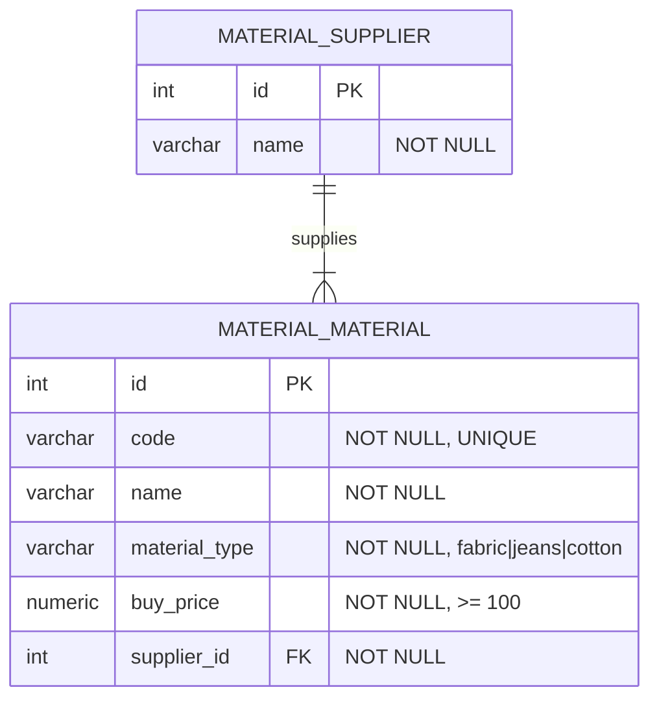
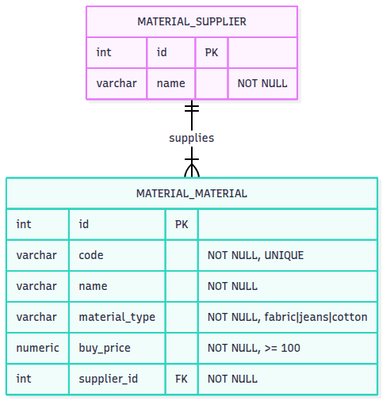

# ERD — Modul Registrasi Material

## Mermaid

## Gambar

## Keterangan

| Tabel | Kolom | Key / Constraint |
|---|---|---|
| `material_supplier` | `id`, `name` | `id` PK |
| `material_material` | `id`, `code`, `name`, `material_type`, `buy_price`, `supplier_id` | `id` PK, `code` UNIQUE, `supplier_id` FK → `material_supplier.id` |

- Relasi: satu supplier memiliki banyak material (1:N); satu material dimiliki tepat satu supplier.
- `material_type` hanya berisi `fabric`, `jeans`, atau `cotton`.
- `buy_price` tidak boleh kurang dari 100.
- Semua kolom wajib terisi (`NOT NULL`).
